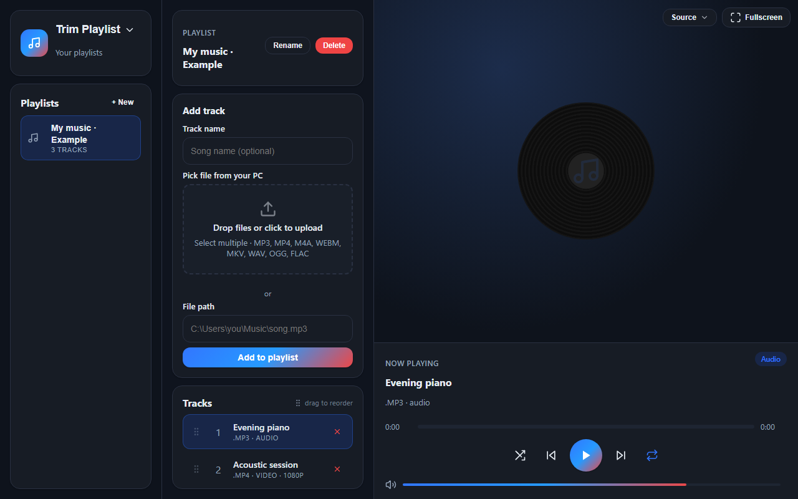

# Trim Playlist

  

Trim Playlist keeps a playlist and can download or trim a video URL. You do that in the app: the Windows window, the same screen in a browser, or the Android and iOS apps.

What changed in this build is in the [release note](https://github.com/DragoonT/url-trimmer/releases/tag/v0.3.2).

## Download this build

The same files are on the [Trim Playlist website](https://dragoont.github.io/url-trimmer/).

| File | Who it is for | How to open it |
|------|----------------|----------------|
| [TrimPlaylist-Windows.zip](https://dragoont.github.io/url-trimmer/downloads/TrimPlaylist-Windows.zip) | Windows | Unzip it. Open **Trim Playlist** inside the `TrimPlaylist` folder. |
| [TrimPlaylist-Setup.exe](https://dragoont.github.io/url-trimmer/downloads/TrimPlaylist-Setup.exe) | Windows | Run the installer. Open **Trim Playlist** from the Start menu. You can also add a desktop shortcut during setup. |
| [TrimPlaylist-Linux.tar.gz](https://dragoont.github.io/url-trimmer/downloads/TrimPlaylist-Linux.tar.gz) | Linux | Unpack it. Run `start.sh` inside the `TrimPlaylist` folder. |
| [TrimPlaylist-Other-OS.zip](https://dragoont.github.io/url-trimmer/downloads/TrimPlaylist-Other-OS.zip) | macOS and NixOS | Unzip it, then follow the system notes below. |

The Windows zip and the installer already include what the app needs. You do not install Python yourself for those two files.

Linux needs GTK and WebKit before `start.sh` will open the window. On Debian and Ubuntu, install `libgtk-3-0` and `libwebkit2gtk-4.1-0`.

On macOS, install Python 3, unzip `TrimPlaylist-Other-OS.zip`, and run `start-macos.command`.

On NixOS, unzip `TrimPlaylist-Other-OS.zip`, run `nix develop`, then run `python trim_playlist_app.py`.

## Phone

The phone apps are version 0.1.0.

- Android: install [TrimPlaylist-Android.apk](https://dragoont.github.io/url-trimmer/downloads/TrimPlaylist-Android.apk). Building it is described in the [Android](Android/README.md) page.
- iPhone: install [TrimPlaylist-iOS.ipa](https://dragoont.github.io/url-trimmer/downloads/TrimPlaylist-iOS.ipa). Building and installing it is described in the [iOS](iOS/README.md) page.

## In the app

Open **Trim URL** from the title at the top left when you want to download. **Trim Playlist** in that same menu returns to the player.

On the phone, **Trim** saves a file cut from Start to End. **Full download** saves the whole file. Downloads are not added to a playlist on their own.

Playlists, cookie files, and downloaded media stay on that computer or phone.

## Authentication

Trim URL asks you to choose one authentication method.

**Cookie file.** Use a `.txt` cookie file. Choose **Create new**, then:

- **Manual .txt** asks for a name. Type the cookie text into that file, the same way you would in a text editor, and save it. The app stores the name as a `.txt` file and selects it.
- **Import .txt file** takes a cookie `.txt` you already have and selects that file.

**Extension account.** This is only for the browser. Install [Trim Playlist Account Connector](https://chromewebstore.google.com/detail/trim-playlist-account-con/fiimgcmfjndfmhpfekbpomiilkdkbnam) from the Chrome Web Store, then choose **Connect with the extension**. The extension opens the platform in the browser and saves the session. The phone app does not use this extension.

**Platform account.** Sign in inside the Trim Playlist window. On the phone, this is the sign-in page inside the app. It does not open a browser tab and it does not use the extension.

**No authentication.** Use this for a public video that does not need a signed-in account.
