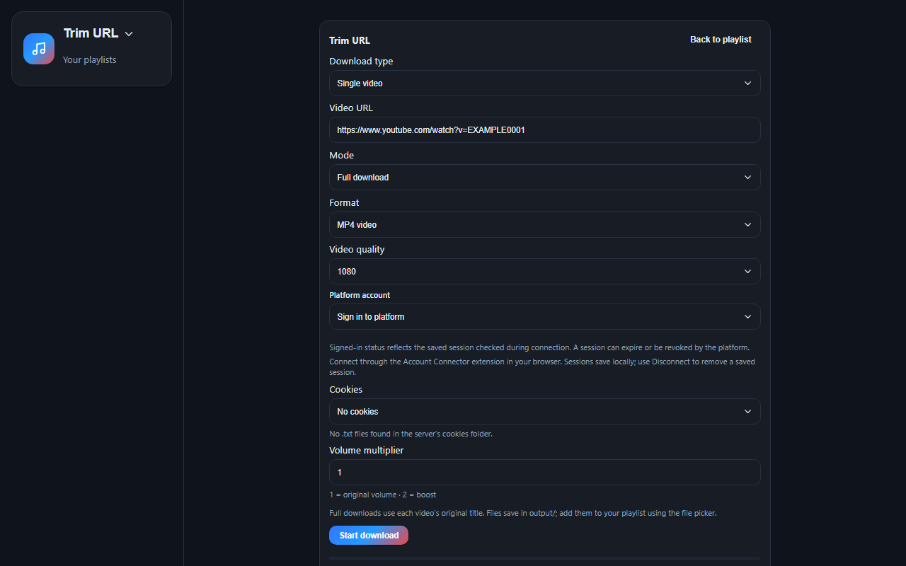

# Trim Playlist

<p align="center">
  
</p>

Trim Playlist is a desktop media player and URL downloader. Build playlists from local MP3/MP4 files, add supported online media, download a video or playlist, and trim downloads into named tracks.

**Windows:** install [TrimPlaylist-Setup.exe](dist/installer/TrimPlaylist-Setup.exe). It adds a Start Menu entry and an optional desktop shortcut; Python is not required after installation.

If Windows removes the unsigned executable, use the [portable source package](dist/portable/TrimPlaylist-portable-source.zip). Extract it, install Python 3.10 or newer, run `pip install -r requirements.txt`, then start `start-playlist.bat`.

## Use Trim Playlist on Android or iPhone

The Android APK and the iPhone IPA are the Trim Playlist player rebuilt for each phone. They are not the Windows `.exe`. Install [TrimPlaylist-Android.apk](Android/dist/TrimPlaylist-Android.apk) or build it from the [Android](Android/README.md) project in Android Studio. Build the iPhone app with [Windows IPA Builder](iOS/README.md) and install the IPA.

On the phone you can create playlists, choose audio and video files on the device, paste a direct media link, reorder tracks, and play them with pause, next, previous, seek, shuffle, repeat, and volume. Playlists stay on that phone.

YouTube and Facebook downloads, trimming, and cookie sign-in stay in the Windows app. Those need the local Python downloader. To open the full Windows player in a phone browser, connect the PC and phone to the same Wi-Fi and run `start-mobile-web.bat` on the PC. It displays an address such as `http://192.168.1.25:8765/`. Open that address in the phone browser.

If Windows Firewall asks, allow Python on **Private** networks. Keep the launcher window open while using the phone browser. The browser connects to the local server; no media or playlist data is uploaded to GitHub Pages.

For development, command-line downloads, and source builds, continue below.

## Supported URLs

| Platform | Example URL |
|----------|-------------|
| YouTube | `https://www.youtube.com/watch?v=VIDEO_ID` |
| YouTube | `https://youtu.be/VIDEO_ID` |
| Facebook | `https://www.facebook.com/watch/?v=VIDEO_ID` |
| Facebook | `https://fb.watch/VIDEO_ID` |
| Facebook | `https://www.facebook.com/share/r/...` |
| Other | Any URL supported by [yt-dlp](https://github.com/yt-dlp/yt-dlp) |

The tool reads a video **URL** from your config and detects the platform automatically.

## Requirements

- Python 3.10+
- Internet connection
- Node.js 22+ or Deno 2+ for YouTube JavaScript challenges, including when using the desktop executable

Dependencies: `yt-dlp`, `imageio-ffmpeg` (FFmpeg bundled — no separate install needed).

## Setup

```powershell
cd url-trimmer
pip install -r requirements.txt
```

## Quick start

1. Copy an example config:

```powershell
copy setlist.youtube.example.json setlist.json
```

2. Edit `setlist.json`:
   - Set your video **url**
   - Add each track with `name`, `start`, and `end`

3. Run:

```powershell
python cut_url.py --config setlist.json
```

Menu:

```
=== Select mode ===
  1. Download full (no trim)
  2. Download and trim tracks
Select [1/2]:

=== Select download quality (MP4) ===
  1. Best available
  2. 1080p
  3. 720p
  4. 480p
  5. 360p
Select [1-5]:
```

Or set quality in config / CLI to skip the quality menu:

```powershell
python cut_url.py --config setlist.json --quality 720
```

Output files go to `output/` and use the **name** from your setlist JSON.

## Modes

| Mode | Description |
|------|-------------|
| **full** | Download entire video/audio as one file (named from setlist) |
| **trim** | Download and cut into separate tracks using start/end times |

```powershell
python cut_url.py --config setlist.json --mode full
python cut_url.py --config setlist.json --mode trim
python cut_url.py --url "https://youtube.com/watch?v=..." --mode full
```

Or in config:

```json
"mode": "full"
```

## Config file

```json
{
  "url": "https://www.youtube.com/watch?v=YOUR_VIDEO_ID",
  "format": "mp4",
  "quality": "720",
  "volume": 2.0,
  "tracks": [
    {
      "name": "Artist - Song Title",
      "start": "0:00",
      "end": "3:30"
    }
  ]
}
```

For Facebook, add a cookies file name (see [Cookies](#cookies)):

```json
{
  "url": "https://www.facebook.com/watch/?v=YOUR_VIDEO_ID",
  "format": "mp4",
  "cookies": "cookies.txt",
  "tracks": [
    {
      "name": "Artist - Song Title",
      "start": "0:00",
      "end": "3:30"
    }
  ]
}
```

Examples: `setlist.youtube.example.json`, `setlist.facebook.example.json`

| Field | Description |
|-------|-------------|
| `url` | Video URL (YouTube, Facebook, etc.) |
| `mode` | `full` or `trim` (optional — shows menu if not set) |
| `format` | `mp3` or `mp4` (MP4 uses H.264 + AAC for mobile editors) |
| `quality` | Download quality — MP4: `best`, `1080`, `720`, `480`, `360` — MP3: `best`, `320`, `192`, `128` |
| `volume` | Volume multiplier (default `2.0`) |
| `normalize` | `true` = auto-normalize loudness |
| `cookies` | Cookie filename inside `cookies/` folder |
| `tracks` | List of songs to cut |
| `tracks[].name` | Output filename |
| `tracks[].start` | Start time (`MM:SS` or `H:MM:SS`) |
| `tracks[].end` | End time (`MM:SS` or `H:MM:SS`) |

**Naming:** Output files follow `name` from setlist — e.g. `"name": "Artist - Song Title"` → `Artist - Song Title.mp4`

## Cookies and private playlists

**Downloading with an existing cookie file does not require the Trim Playlist Account Connector extension.** Public content may work without cookies; private playlists and other account-restricted content require a fresh session from an account that can access that content.

### Use a cookie file in the app

1. Open the video or playlist in your browser and confirm it is accessible to the signed-in account.
2. Obtain a fresh Netscape-format cookie export for that platform. If you already have a valid export, no extension is needed to use it in Trim Playlist. Browser export tools are optional ways to create the file.
3. Put the `.txt` file in this project's `cookies/` folder, or import it using the personal setup tool below.
4. Open **Trim Playlist → Trim URL** using the title menu at the top left.
5. Choose **Authentication → Cookie file**, then select the correct filename in **Cookies**. Platform account mode shows only the platform you select; choose No authentication for public content if appropriate.
6. Select **Single video** or **Entire playlist** and paste the URL. With Single video and a playlist URL, Start download loads a picker: choose one or more items, then click Download selected. Trim mode allows exactly one selected item. Entire playlist downloads all items directly in Full mode.
7. Choose MP4 video quality or MP3 audio quality, then click **Start download**.

The Cookies dropdown reads `.txt` files from `cookies/` and excludes `README.txt`. Open the dropdown to refresh its list after adding a file. A filename does not prove that a session is valid: different exports for the same account can have different expiry dates or authentication state.

For the command-line trimmer, reference only the filename inside `cookies/`:

```json
"cookies": "platform_cookie.txt"
```

Keep cookie files private. They contain account credentials, are stored as local text files, and are excluded from Git. Do not upload them to GitHub or include them in examples, screenshots, or support messages.

### Personal setup: one executable

Run **`dist/personal-setup/TrimPlaylistPersonalSetup.exe`** from within this project. It offers:

- **Import a cookie file**: choose an exported Netscape `.txt` file. The tool keeps unexpired cookies for supported platforms, saves a new `imported_*.txt` file in `cookies/`, and preserves existing cookie files. Select the new filename in Trim URL. This action needs no connector extension.
- **Prepare personal extension**: copies the bundled connector into `browser-extension-personal/` and opens that folder. This is optional. For the unpublished connector, your browser still requires Developer mode and **Load unpacked**; the setup tool does not automatically install a browser extension.

The setup tool does not create a signed-in session on its own. It imports an existing export or prepares the optional connector.

## Online tracks in Trim Playlist

The **Add track** panel has a **Source** control:

- **Offline** adds files from your PC, as before.
- **Online** adds a video or audio stream by URL without downloading a media file into the playlist.

For an online URL, choose an optional cookie file, select **Video** or **Audio only**, then click **Load URL**. A playlist URL shows every available video. Choose **Single video** to select one item, or **Entire playlist** to add all available items. The saved playlist can mix online and offline tracks.

Online tracks show an **Online** or **Offline** connection badge in the Tracks panel. Playback requires an internet connection and, for private content, a cookie session that still has access. The app keeps the URL and selected cookie filename locally; it does not save streamed media files or signed stream URLs.

## Command line

```powershell
python cut_url.py --url "https://youtube.com/watch?v=YOUR_VIDEO_ID" --start 15:52 --end 19:20 --name "Artist - Song"
python cut_url.py --url "https://facebook.com/watch/?v=YOUR_VIDEO_ID" --mode full --format mp4 --cookies cookies.txt
```

### Options

| Option | Description |
|--------|-------------|
| `--config`, `-c` | JSON config file |
| `--url`, `-u` | Video URL |
| `--mode`, `-m` | `full` or `trim` |
| `--start`, `-s` | Start time |
| `--end`, `-e` | End time |
| `--name`, `-n` | Track name |
| `--format`, `-f` | `mp3` or `mp4` |
| `--quality`, `-q` | Download quality: MP4 `best`/`1080`/`720`/`480`/`360`, MP3 `best`/`320`/`192`/`128` |
| `--volume` | Volume multiplier (default `2.0`) |
| `--normalize` | Auto-normalize loudness |
| `--cookies` | Cookie file in `cookies/` folder |
| `--output`, `-o` | Output folder (default: `output`) |
| `--keep-source` | Keep downloaded source after cutting |

## Volume

Default **2x** boost with limiter (quieter exports are common):

```json
"volume": 2.0
```

Use `"volume": 1.0` for original level, or `"normalize": true` for auto-normalize.

## MP4 for video editors

MP4 files are re-encoded to **H.264 + AAC** (`yuv420p`) so they work in CapCut and other mobile editors. Older downloads (VP9/AV1) may show "Unsupported format" — re-run after deleting old files in `output/`.

## Progress

```
[==============----------------]  45% Downloading...
[==============================] 100% Download complete
[===============---------------]  50% Cutting 1/2...
[==============================] 100% All tracks cut
```

## Troubleshooting

**Download failed**

```powershell
python -m pip install --upgrade --pre "yt-dlp[default]"
```

**Private playlist says “playlist does not exist”** — verify the exact URL in your signed-in browser, then select a fresh cookie export from that account. YouTube can return this message when the supplied session cannot access the playlist. Switching to a valid export can resolve it; installing the connector is not required.

**Playlist loads but video formats fail** — install a supported Node.js or Deno runtime. The web/desktop downloader enables both runtimes and uses the one available. Cookies provide authentication; the runtime handles YouTube JavaScript challenges.

**“The page needs to be reloaded”** — update the downloader dependencies and rebuild the executable. Updating Python packages does not update a previously built `.exe`.

**Facebook / private videos** — select the appropriate cookies file in `cookies/`.

**Wrong format (mp3 vs mp4)** — set `"format": "mp4"` in config; delete old files in `output/`.

**Re-cut** — delete output files and run again. Delete `output/_cache_*` to re-download.

## Trim Playlist desktop app

<p align="center">
  
</p>

Create your own playlists with custom names and pick files yourself:

```powershell
python trim_playlist_app.py
```

Or double-click **`start-playlist.bat`**. Opens in its **own app window** (not a browser tab).

### Installers and other operating systems

Windows users can install [TrimPlaylist-Setup.exe](dist/installer/TrimPlaylist-Setup.exe). Installer source and native build instructions are in [packaging/README.md](packaging/README.md). Linux and macOS builds must be made on Linux and macOS. Android and iOS need a dedicated mobile version because the current desktop downloader relies on local Python, yt-dlp, and FFmpeg.

For browser mode with Python:

```powershell
python playlist_server.py
```

### How to use

1. Click **+ New** → create playlist name
2. **Add track**:
   - Pick file from your PC (mp3, mp4, etc.), or
   - Paste file path like `C:\Users\you\Music\song.mp3`
3. Click track to play
4. **MP4** = watch video, **MP3** = listen
5. **Repeat**: off → repeat playlist → repeat one track

Playlists saved in `playlists/` folder (not from `output/` auto-scan).

Playback position is saved in **`player-session.json`** (same folder as the app). Browser and `.exe` share it — close one, open the other, and it continues the same track and time.

## Run as .exe (no Python needed)

Build once (requires Python on your PC):

```powershell
cd url-trimmer
.\build-exe.bat
```

Then double-click:

- **`dist\TrimPlaylist\TrimPlaylist.exe`** — starts the server automatically and opens the app window
- **`dist\TrimPlaylist\Run Trim Playlist.bat`** — same shortcut
- **`trim-url.bat`** — download/trim URLs (recommended; uses Python, same as `cut_url.py`)

Optional: **`dist\UrlTrimmer\UrlTrimmer.exe`** — same trimmer without Python installed. **Windows Security may delete this file** (false positive). If it disappears, use **`trim-url.bat`** instead, or add an exclusion in Windows Security for `url-trimmer\dist\UrlTrimmer`.

No need to run `python playlist_server.py` first. The server runs **inside** the `.exe`. Close the app window to stop the server and free the port.

If port `8765` is already in use (browser or another `.exe` open), the next free port is picked automatically (8766, 8767, …).

**Data folders** (`playlists/`, `player-session.json`, `output/`, `cookies/`) live beside the source when you run from this repository. The portable `.exe` does the same. The installed Windows app stores them in `%LOCALAPPDATA%\Trim Playlist` so it does not need write permission in Program Files. Set `TRIM_PLAYLIST_DIR` to use a different folder.

You can copy the whole `dist/TrimPlaylist` or `dist/UrlTrimmer` folder to another PC — no Python install required. On another PC, data is stored next to the `.exe` unless you set `TRIM_PLAYLIST_DIR` to a custom folder.

## Download inside Trim Playlist

Click the **Trim Playlist** title at the top left and select **Trim URL**. Choose **Trim Playlist** in the same menu to return to your player. Choose **Single video** or **Entire playlist**, then enter its URL. Single videos support Full download or Trim; entire playlists always use Full mode and each video’s original title. Trim accepts an optional filename and requires start/end times. MP4 offers video resolution choices; MP3 offers Best quality (VBR) or 64–320 kbps audio bitrate choices. Encoding at a higher bitrate cannot restore quality missing from the source. Optional cookies are read from cookies/. Completed files save in output/ and can be picked for your local playlist.

### Optional account connector

The **Sign in to platform** option uses Trim Playlist Account Connector to save a browser session automatically. This is an alternative to importing cookie files, not a requirement for authenticated downloads. It opens the selected platform in your default browser, including Helium. Passwords are entered on the platform's own page; imported sessions stay in this project.

The connector has been submitted to the Chrome Web Store and is awaiting review. Store installation is not available until it is approved and published. The connection page does not offer a ZIP download. For personal testing, use the setup tool's **Prepare personal extension** action and then your browser's **Load unpacked** workflow. See [connector setup](browser-extension/README.md).

### YouTube authenticated downloads

The downloader includes the October 10, 2026 fix for YouTube's authenticated playback error, “The page needs to be reloaded.” The web/desktop download options enable Node.js alongside Deno for JavaScript challenges. A supported runtime must be installed even when running the packaged desktop app.

Private-playlist access and an actual audio transfer were verified using an existing cookie export with Node.js enabled, without the account connector. This validates the cookie-file workflow; access still depends on the account, session validity, and each item's availability. Re-export cookies if they expire or the platform rotates the session.

Rebuild the desktop app after updating dependencies or downloader code. Updating Python packages alone does not change the bundled executable.

### Playlist selection and authentication controls

Single video with a playlist URL opens an item picker before downloading. No items are selected automatically. Unavailable entries are disabled. Full mode permits one or several selected videos; Trim mode permits one. Changing URL, authentication, or export settings clears the preview so selections cannot apply to a different request. Entire playlist remains the explicit way to download every item.

Progress counts the selected files sequentially: selecting original playlist item 7 alone shows 1/1, and selecting two items shows 1/2 then 2/2.

Authentication controls are mutually exclusive: Cookie file shows the cookie dropdown, Platform account shows only the selected platform and its connection status, and No authentication uses neither saved session.

## Contributing

See [CONTRIBUTING.md](CONTRIBUTING.md) for local setup, validation, and contribution guidance.

## Mobile workspaces

The [Android](Android/README.md) and [iOS](iOS/README.md) apps are on-device players. They play files chosen on the phone and direct media links. They do not embed the desktop Python downloader or accept browser cookies. A future shared download service is described separately in [mobile-api.md](mobile-api.md).

## License

This project is licensed under the [MIT License](LICENSE).
